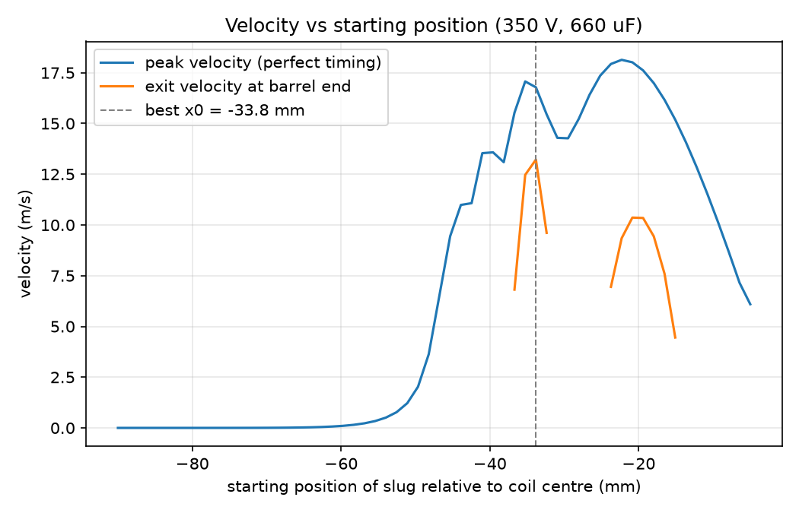
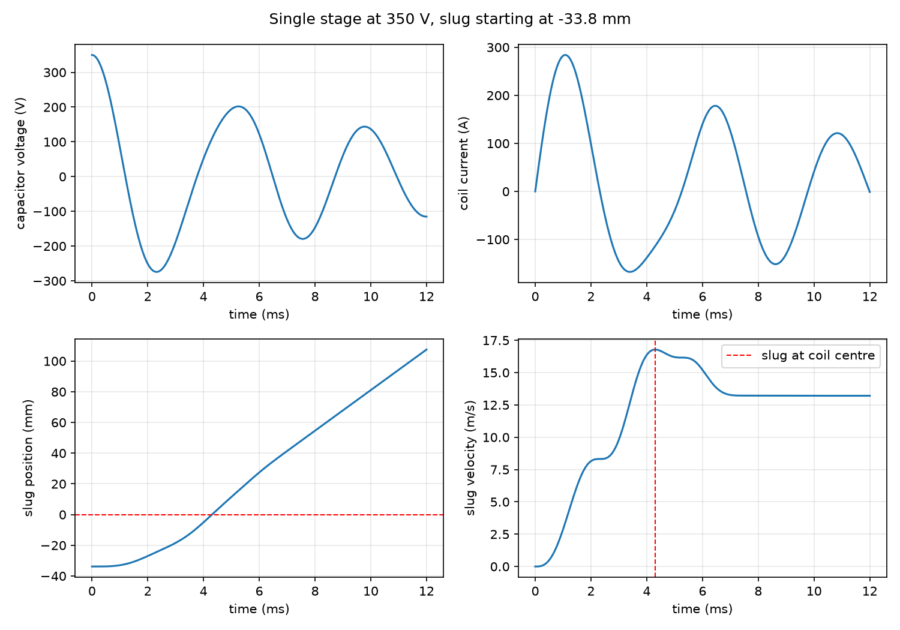

# Coilgun Simulator


A physics simulator for a single coilgun stage. It couples the capacitor discharge circuit to the
motion of the projectile through a position-dependent inductance, integrates the whole thing with
a custom RK4 solver, and reports muzzle velocity plus the projectile starting position that
maximises it.

It handles two kinds of projectile with one set of equations: a plain ferromagnetic slug, and a
permanent magnet.

I built the coilgun (V3) this models. Firing a 54.64 g steel slug at 350 V, it chronographs at
roughly **6-7 m/s**. The point of the project was to predict that from first principles and then
be honest about the gap.

---

## Running it

### 1. Check your Python

You need Python 3.10 or newer.

```bash
python --version
```

If that prints something older, or says the command is not found, install Python from
[python.org](https://www.python.org/downloads/). On Windows, tick **"Add Python to PATH"** during
install. On some systems the command is `python3` instead of `python` -- if so, use `python3`
everywhere below.

### 2. Get the code and install the dependencies

```bash
git clone https://github.com/SomeHeresy/Coilgun-Simulator.git
cd Coilgun-Simulator
```

A virtual environment is optional but keeps these packages out of your system Python:

```bash
python -m venv .venv
```

Activate it -- on Windows:

```bash
.venv\Scripts\activate
```

on macOS or Linux:

```bash
source .venv/bin/activate
```

Then install what the project needs (numpy, matplotlib, pytest):

```bash
pip install -r requirements.txt
```

### 3. Run your first simulation

```bash
python -m coilgun.cli
```

That simulates my actual V3 hardware and prints:

```
ferromagnetic slug, 54.64 g, fired at 350 V from x0 = -22.0 mm
Peak velocity:  18.1358 m/s
Exit velocity:  9.6437 m/s
Suckback loss between peak and exit: 8.4921 m/s (46.8%)
Efficiency: 2.541 J of 40.4 J = 6.29%
Energy identity holds to 5.75e-14 relative
```

Note the `-m`. It runs the code as part of the `coilgun` package, which is what makes the imports
resolve. Running `python coilgun/cli.py` directly will fail with an ImportError.

---

## Four ways to give it your own numbers

**Nothing here requires editing Python source.** Pick whichever suits you.

### A. Interactive -- it asks you

The friendliest option if you have not used the tool before:

```bash
python -m coilgun.cli --interactive
```

It walks you through every parameter, grouped by what they belong to, showing the current value in
brackets. **Press Enter to keep a value**, or type a new one:

```
Coilgun simulator -- press Enter to keep the value in brackets.

Projectile type (steel/magnet) [steel]: magnet

Capacitor bank
  Charge voltage, V [350.0]: 400
  Capacitance, F [0.00066]:
  Circuit resistance, ohm [0.15]:

Coil and projectile
  Coil inductance with slug far away L0, H [0.00075]:
  Inductance rise with slug centred dL, H [4e-05]:
  Width of the inductance bump a, m [0.0191]:
  Projectile mass, kg [0.03923]:
  Starting position, m (negative = before coil centre) [-0.022]:
  Barrel end, m from coil centre [0.05]:
  Peak flux linkage of the magnet, Wb [0.015]:
  Width of the flux linkage bump, m [0.0191]:

Solver
  Time step, s [1e-06]:
  Number of steps [45000]:
```

Choosing `steel` or `magnet` loads that projectile's whole parameter set, so you do not have to
remember which mass goes with which inductance. Typing something that is not a number just asks
again rather than crashing. Ctrl-C or Ctrl-D quits cleanly.

`-i` is the short form.

### B. Command line flags -- one value at a time

Every parameter has a flag. Good for quick experiments and for scripting:

```bash
python -m coilgun.cli --V0 400
```

```bash
python -m coilgun.cli --V0 500 --x0 -0.034 --mass 0.040
```

List them all with their current defaults:

```bash
python -m coilgun.cli --help
```

The flags are generated from the `Config` dataclass, so a parameter added there gets a flag
automatically.

### C. A JSON config file -- for setups you reuse

Two are included:

```bash
python -m coilgun.cli --config configs/v3_steel.json
python -m coilgun.cli --config configs/v3_magnet.json
```

To make your own, copy one and edit it. A config only needs the keys it changes -- everything else
falls back to the defaults:

```json
{
  "V0": 450.0,
  "mass": 0.030,
  "x0": -0.030
}
```

```bash
python -m coilgun.cli --config configs/my_setup.json
```

If you misspell a key you get told, rather than the run silently ignoring it:

```
unknown keys in configs/my_setup.json: volts
```

### D. Editing the defaults

If you want your own hardware to be what runs when you type `python -m coilgun.cli` with no
arguments, edit the values in `coilgun/config.py`. Every field has a comment giving its units and
saying whether it is measured or estimated.

### They stack

The layers override each other in this order, each beating the ones before it:

```
config.py defaults  ->  --config file  ->  command line flags  ->  --interactive
```

So you can load a saved setup and change one thing:

```bash
python -m coilgun.cli --config configs/v3_steel.json --V0 500
```

or load a setup and then be walked through it with everything pre-filled:

```bash
python -m coilgun.cli --config configs/v3_magnet.json --interactive
```

---

## Reading the output

```
ferromagnetic slug, 54.64 g, fired at 350 V from x0 = -22.0 mm
```
What was simulated. `x0` is the projectile's starting position measured from the coil centre;
negative means behind it.

```
Peak velocity:  18.1358 m/s
```
The fastest the projectile ever goes, which happens at the coil centre. This is what you would get
with perfect switch timing -- cutting the current at exactly the right instant.

```
Exit velocity:  9.6437 m/s
```
Speed at the barrel end. **This is the number a chronograph measures**, and the one to compare
against real hardware.

```
Suckback loss between peak and exit: 8.4921 m/s (46.8%)
```
How much speed the coil took back after the projectile passed centre. Large numbers here mean your
current is still flowing when it should not be.

```
Efficiency: 2.541 J of 40.4 J = 6.29%
```
Muzzle kinetic energy as a fraction of the energy stored in the capacitor bank. Real single-stage
coilguns are typically 1-3%.

```
Energy identity holds to 5.75e-14 relative
```
A self-check that the integrator is not inventing or losing energy. **Anything much above about
1e-10 means the result should not be trusted** -- usually a step size that is too large.

---

## Saving and plotting results

Write the full time series (time, voltage, current, position, velocity, dissipated heat) to CSV:

```bash
python -m coilgun.cli --config configs/v3_steel.json --csv results.csv
```

One row per step plus the starting state, so 12000 steps gives 12001 data rows under a header
line. Open it in Excel, or plot it yourself.

Generate the plots -- velocity against starting position, plus the four time-series panels:

```bash
python -m coilgun.sweep
```

This writes `results_sweep.png`, `results_timeseries.png` and `results_sweep.csv`. It runs 60
simulations and takes a few seconds.

---

## Running the tests

```bash
python -m pytest tests/ -v
```

22 tests, about a second. They also run automatically on every push via GitHub Actions.

---

## Other scripts

These print diagnostics rather than asserting, and were the checks I used while building each
stage. They take no arguments and read `coilgun/config.py` directly:

```bash
python -m coilgun.force              # verifies dL/dx against a numerical derivative
python -m coilgun.run_rlc            # circuit only, with an energy check
python -m coilgun.validate_rlc       # circuit vs the analytic solution, convergence order
python -m coilgun.run_coilgun        # full model, energy identity, writes a CSV
python -m coilgun.validate_coilgun   # convergence order for the coupled model
```

---

## If something goes wrong

**`No module named coilgun`** -- you are not in the project folder, or you dropped the `-m`. Run
from the directory containing the `coilgun/` folder, and use `python -m coilgun.cli`.

**`No module named numpy` / `matplotlib` / `pytest`** -- dependencies are not installed, or your
virtual environment is not activated. Run `pip install -r requirements.txt`.

**`slug never reached x_exit=50.0 mm (got to +10.94 mm)`** -- the simulation ended before the
projectile left the barrel. Increase `--steps`, or lower `--x_exit`. The magnet needs far more
steps than the steel slug because it is slower.

**`unknown keys in ...`** -- a typo in your JSON. The message names the offending key. Check it
against `python -m coilgun.cli --help`.

**Peak velocity is almost zero** -- the projectile probably starts outside the region where the
force exists. `x0` and `a` are coupled: a narrow inductance bump means the projectile has to start
closer to the coil. Try `--x0` around the same magnitude as `--a`.

**Energy identity is large (above 1e-10)** -- the time step is too big for the parameters. Lower
`--dt` and raise `--steps` by the same factor to cover the same span of time.

---

## The physics

### Circuit

A charged capacitor discharging through the coil is a series RLC circuit. With state `[V, I]`:

```
dV/dt = -I / C
dI/dt = (V - I*R) / L
```

At 350 V, 660 uF, 750 uH and 0.15 ohm this gives alpha = 100 and omega_0 = 1421 rad/s, so
alpha < omega_0 and the circuit is underdamped. The current rings rather than decaying smoothly,
which is what a real capacitor bank does.

### Adding the projectile

The coil's inductance depends on where the slug is, and that dependence is the entire source of
the force. Modelled as a Gaussian bump centred on the coil:

```
L(x)  = L0 + dL * exp(-(x/a)^2)
dL/dx = -(2x/a^2) * dL * exp(-(x/a)^2)
```

The state becomes `[V, I, x, v, W]` and the equations are:

```
dV/dt = -I / C
dI/dt = (V - I*R - I*v*dL/dx - v*dlambda_pm/dx) / L(x)
dx/dt = v
dv/dt = (0.5 * I^2 * dL/dx + I * dlambda_pm/dx) / m
dW/dt = I^2 * R
```

Two things matter here.

**The force must come from dL/dx.** A force term that does not trace back to the same `L(x)` the
circuit sees through its back-EMF lets the slug gain energy the capacitor never paid for. That is
not an inaccuracy, it is a free energy machine, and it would neither crash nor look obviously
wrong. The `I*v*dL/dx` term in `dI/dt` and the `0.5*I^2*dL/dx` term in `dv/dt` are two halves of
the same bookkeeping.

**W is a state variable, not a post-processing step.** Carrying cumulative resistive heat inside
the integrator makes the energy identity below exact to the same order as everything else.

### Permanent magnets

A ferromagnetic slug only changes the coil's own inductance. A permanent magnet also pushes its
own flux through the coil, independent of the current. Writing the total flux linkage as

```
lambda = L(x) * I + lambda_pm(x)
```

covers both cases in one set of equations, and `lambda_pm = 0` reduces exactly to the
ferromagnetic case. The two forces behave differently: the reluctance force is quadratic in
current so it cannot tell direction, while the magnet force is linear, so reversing the current
or flipping the magnet reverses it.

The magnet preset uses a much smaller `dL` on purpose. NdFeB has a recoil permeability near 1.05,
so magnetically it is almost air and barely raises the coil's inductance, while soft steel raises
it a lot. Giving the magnet the steel `dL` would count the same force twice.

### Suckback

`dL/dx` changes sign at the coil centre. The coil pulls the slug in on approach and drags it back
after it passes through. Nothing puts that in the model by hand; it falls out, and the simulated
peak velocity lands at x = -0.01 mm, which is the coil centre to within a hundredth of a
millimetre.

Deciding when to cut the current, or where to start the slug, is the whole problem.

---

## How I know it is right

Four checks, all automated in `tests/`.

**1. Against the closed-form solution.** The underdamped RLC has an exact analytic answer. Max
error stays below 1e-5 relative across the full run.

**2. Convergence order.** A true 4th-order method cuts its error by 16x when the step size halves.
Measured **16.01** for the circuit and **16.04** for the full coupled model.

This one needs care. At the production step size the error is already down near 1e-14 relative,
which is the double precision floor, and the ratio then measures rounding noise instead of the
method -- it reads about 14.7 with nothing actually wrong. The tests deliberately use a coarser
step so truncation error stays well above that floor.

**3. Energy.** Capacitor plus inductor plus kinetic plus dissipated heat must stay constant at
every step:

```
0.5*C*V^2 + 0.5*L(x)*I^2 + 0.5*m*v^2 + W = constant
```

Holds to **6e-14 relative**, for both projectile types. This is the check that would catch the
free-energy bug, and nothing else would.

**4. The derivatives are verified numerically.** A dropped factor of 2 or a flipped sign in
`dL/dx` would not crash, it would just produce a plausible wrong answer. Both analytic derivatives
are compared against a central difference at several positions; agreement is around 1e-11
relative.

### The tests can actually fail

A green suite proves nothing until you have watched it go red, so I broke the code on purpose:

| Deliberate bug | Caught by |
| --- | --- |
| Removed the back-EMF term (the free-energy bug) | energy conservation, both projectiles |
| Flipped the sign of the force | energy conservation + peak-at-centre |
| Dropped the factor of 2 in `dL/dx` | numerical derivative check |

Each was caught by the test written for it, with no spurious failures elsewhere. There is also a
test asserting that `lambda_pm = 0` reproduces the ferromagnetic results bit for bit, so adding
magnet support could not quietly move results that were already validated.

22 tests, about 0.9 seconds, run on Python 3.10 / 3.12 / 3.13 in CI.

---

## Results

Firing the 54.64 g steel slug at 350 V from where it actually sits on the hardware (centre 22 mm
behind the coil centre, so half the slug starts inside the coil):

| | |
| --- | --- |
| Peak velocity | 18.14 m/s |
| Exit velocity at barrel end | 9.64 m/s |
| Lost to suckback | **46.8%** |
| Predicted efficiency | 6.29% |
| Measured velocity | 6-7 m/s |
| Measured efficiency | 2.86% |

Almost half the muzzle velocity is thrown away after the slug passes the coil centre.



Sweeping the starting position gives a prediction I can test on the hardware:

```
Best peak velocity: 18.14 m/s at x0 = -22.3 mm   <- essentially where I put it
Best exit velocity: 13.22 m/s at x0 = -33.8 mm
```

I placed the slug almost exactly where peak velocity is maximised. But peak is not what leaves the
barrel. Starting the slug about 12 mm further back trades a little peak speed for much less
braking time, and the model says that is worth **9.64 -> 13.22 m/s, a 37% gain, for free**. That
is the next thing to try on the actual coilgun.



---

## Honesty about the gap

The model predicts 9.64 m/s where I measure 6-7. It over-predicts by roughly 45%.

I have not tuned any parameter to close that gap. The numbers above are what the model says with
parameters chosen independently of the measurement. An over-prediction is the expected direction
for a model that omits every loss mechanism listed below.

**What the model leaves out**

- **Eddy currents.** The slug is a solid 44 mm cylinder in a fast-changing field. Induced currents
  inside it dissipate energy and oppose the flux change. Probably the largest missing term.
- **Magnetic saturation.** `L(x)` is treated as independent of current. At a peak current in the
  hundreds of amps the core saturates and the real inductance rise is smaller than modelled.
- **Friction** between slug and barrel.
- **Temperature.** Coil resistance rises as it heats during the pulse; `R` is constant here.

**Parameters that are estimates, not measurements**

- `L0 = 750 uH`. Wheeler's multilayer formula gives about **590 uH** for 280 turns on this coil
  geometry, so the value is the right order but wants an LCR meter.
- `dL`, the inductance rise with the slug centred. Not measured, and results are very sensitive
  to it.
- `a = 20.5 mm`, the width of the inductance bump. Derived from geometry rather than fitted: coil
  and slug stop overlapping at |x| = (44 + 44)/2 = 44 mm, and a Gaussian is down to about 1% at
  2.15a. That "1% at 2.15a" is a convention I chose, not a law, and this is the single most
  sensitive parameter in the model.
- `lambda_pm` for the magnet is invented. The magnet results show shape, not magnitude.
- `R = 0.15 ohm`.

**Approximations worth naming**

- The slug is treated as a point at position `x`, but it is 44 mm long and the coil is 44 mm long.
  A projectile as long as the coil is the crudest approximation in the whole model, and it is why
  `a` has no cleaner derivation.
- `L(x)` is a Gaussian because it is smooth and has the right qualitative shape, not because the
  real geometry produces one.
- One stage only.
- No flyback diode. Adding one makes the ODE non-smooth and would degrade fixed-step RK4 to about
  first order across the switching instant, so the 16x convergence check would stop holding.

**A loose end.** The steel slug measures 13 mm x 44 mm but weighs 54.64 g, which works out to
9.36 g/cm3 -- too dense for plain steel. Either it is wider than 13 mm or it is a different alloy.
Only the mass enters the equations and the mass is measured, so this does not affect any result,
but I have not identified the material.

---

## Layout

```
coilgun/
├── config.py               # every simulation parameter, one dataclass
├── integrator_rk4.py       # generic RK4 stepper, knows no physics
├── rlc.py                  # circuit-only derivative, [V, I]
├── force.py                # L(x), dL/dx, and the permanent magnet flux linkage
├── coilgun_derivative.py   # the coupled 5-variable derivative
├── simulate.py             # shared run loop + peak/exit velocity
├── cli.py                  # argparse + JSON config entry point
├── sweep.py                # starting-position sweep and plots
├── run_rlc.py              # circuit-only driver + energy check
├── run_coilgun.py          # full driver + energy identity check
├── validate_rlc.py         # analytic + convergence, prints rather than asserts
└── validate_coilgun.py     # convergence for the coupled model
configs/                    # JSON parameter sets for the two projectiles
tests/                      # the same checks as pytest, run in CI
scratch/
└── integrator_euler.py     # first attempt, plain Euler on an RC circuit, kept for reference
```

The integrator knows no physics. It takes a state vector, a step size, and a derivative function,
so growing from a 1-variable RC circuit to the 5-variable coupled model never required changing
it. It does take an explicit `t`, which does nothing today because the system is autonomous, but
which stops the method silently dropping below 4th order if switch timing is added later.

---

## What I wrote, and where I used AI

I used AI assistants (OpenAI Codex and Anthropic Claude) on this project. The split below is
accurate.

**I wrote the physics and the numerical core myself:**

- The RK4 integrator, including making it generic over the derivative function so it would not
  need rewriting as the state grew.
- The RLC derivative and the circuit driver.
- The analytic underdamped RLC solution and the convergence test that compares against it.
- `L(x)` and `dL/dx`, and the finite-difference check verifying they are consistent.
- The full 5-variable coupled derivative, including working out that the back-EMF and force terms
  have to be paired, and carrying dissipated energy `W` as a state variable.
- The energy conservation checks.
- All the hardware and its measurements.

**AI assistance, and what it was for:**

- **Code review that changed the design.** My RK4 stepper originally took no time argument. That
  is invisible for an autonomous system but would have silently broken switch timing later. Also
  flagged: my convergence test had bottomed out in floating-point rounding noise and was reading
  14.7 instead of 16 with nothing actually wrong, and my starting position and bump width were
  coupled in a way that made a one-parameter sweep give a confidently wrong answer.
- **Physics I did not know.** That a permanent magnet needs a flux-linkage term rather than the
  reluctance force, and that NdFeB's recoil permeability means it barely changes coil inductance.
- **Parameter derivation.** The Wheeler's-formula estimate for `L0`, the geometric argument for
  `a`, and the slug density check.
- **Plumbing.** The CLI and JSON config loading, the CSV writer, the sweep and plotting script,
  the pytest suite, and the CI workflow.
- **This README.**

<!-- TODO: add what you specifically used Codex for. -->

The physics, the integrator, and the validation strategy are mine. The tooling around them is
substantially AI-assisted, and the design review caught real bugs before they mattered.
